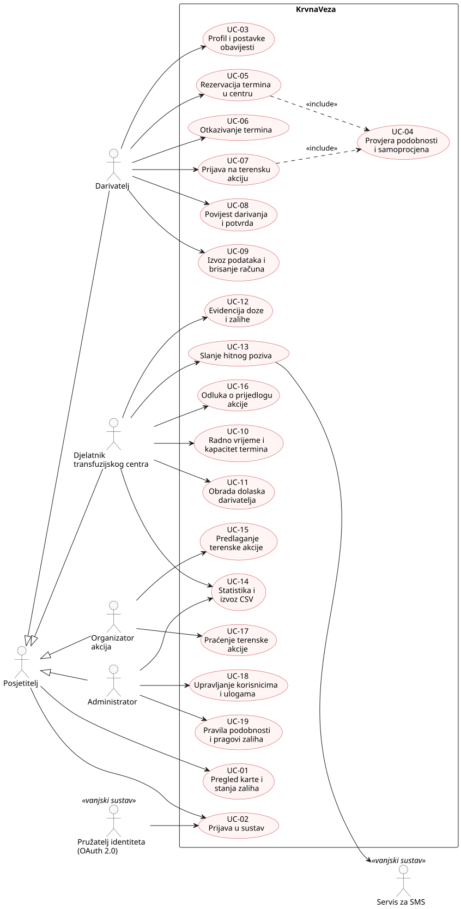

# 3. Obrasci uporabe

**Cilj:** Prikazati glavne interakcije između aktera aplikacije i sustava. Opišite kako akter ostvaruje cilj i što se događa kada važan korak ne uspije. Interakcije temeljite na odobrenim zahtjevima i ažurirajte ih kako se aplikacija razvija.

## 3.1 Dijagram obrazaca uporabe

**Slika 3.1. Dijagram obrazaca sustava KrvnaVeza**

**PlantUML izvor:** [izvor](./puml/3-1-KrvnaVeza-system-UC.puml)

**Provjera dijagrama:** Prikažite prepoznate uloge koje **komuniciraju s aplikacijom**, a ne dionike koji s njom nemaju interakciju. Svaki glavni korisnički cilj mora imati pridruženog aktera; uključeni obrazac uporabe može se dosegnuti preko drugog obrasca uporabe bez vlastite izravne veze s akterom. `<<include>>` i `<<extend>>` koristite samo kada odnos odgovara stvarnom ponašanju.

## 3.2 Specifikacije obrazaca uporabe

**Cilj:** Za svaki obrazac uporabe iz dijagrama objasniti cilj aktera, uobičajenu interakciju s aplikacijom i važne alternative. Jednostavne obrasce uporabe opišite kratko; proširite one kod kojih alternative, vanjske ovisnosti ili posljedice zahtijevaju dodatno objašnjenje.

### UC-01: Pregled karte i stanja zaliha

| Element specifikacije | Opis |
| :--- | :--- |
| **Primarni akter** | Posjetitelj i svi prijavljeni akteri |
| **Povezani zahtjevi** | F-001, F-020 |
| **Preduvjeti** | Nema. |
| **Glavni uspješni tok** | 1. Posjetitelj otvara početnu stranicu. 2. Sustav prikazuje kartu s transfuzijskim centrima i najavljenim akcijama. 3. Sustav prikazuje razinu zalihe (kritično, nisko, dovoljno) za svaku krvnu grupu. 4. Posjetitelj odabire centar ili akciju, sustav prikazuje njihove pojedinosti. |
| **Alternativni tokovi / Iznimke** | **2a — Karta nije dostupna:** Vanjska usluga za kartu ne odgovara. Sustav prikazuje popis centara i akcija bez karte. **4a — Nema najavljenih akcija:** Sustav prikazuje poruku da trenutno nema najavljenih akcija. |
| **Posljedice (ishod)** | Podaci se samo prikazuju, stanje sustava se ne mijenja. |

### UC-02: Prijava u sustav

| Element specifikacije | Opis |
| :--- | :--- |
| **Primarni akter** | Posjetitelj |
| **Sekundarni akter** | Pružatelj identiteta (OAuth 2.0) |
| **Povezani zahtjevi** | F-002 |
| **Preduvjeti** | Posjetitelj nije prijavljen. |
| **Glavni uspješni tok** | 1. Posjetitelj odabire prijavu. 2. Sustav ga preusmjerava pružatelju identiteta. 3. Posjetitelj se autentificira kod pružatelja identiteta i odobrava pristup. 4. Pružatelj vraća posjetitelja u sustav uz potvrđenu adresu e-pošte i token. 5. Sustav pri prvoj prijavi stvara račun darivatelja. Inače prepoznaje postojeći račun i njegovu ulogu. 6. Sustav prikazuje funkcije koje odgovaraju ulozi. |
| **Alternativni tokovi / Iznimke** | **3a — Odustajanje ili odbijanje:** Posjetitelj odustane ili odbije pristup, sustav se vraća na javni prikaz bez prijave. **4a — Adresa e-pošte nije valjana ili nije potvrđena:** Sustav odbija prijavu i objašnjava razlog. **5a — Račun je deaktiviran:** Sustav odbija prijavu uz poruku da je račun deaktiviran. |
| **Posljedice (ishod)** | Posjetitelj je prijavljen s ovlastima svoje uloge, te je pri prvoj prijavi stvoren račun darivatelja. |

### UC-03: Upravljanje profilom i postavkama obavijesti

| Element specifikacije | Opis |
| :--- | :--- |
| **Primarni akter** | Darivatelj |
| **Povezani zahtjevi** | F-003, F-004, F-005 |
| **Preduvjeti** | Darivatelj je prijavljen. |
| **Glavni uspješni tok** | 1. Darivatelj otvara profil. 2. Unosi ili mijenja ime i prezime, datum rođenja, spol, mjesto stanovanja, broj mobilnog telefona i krvnu grupu (ako mu je poznata). 3. Odabire način primanja obavijesti i najveću udaljenost za obavijesti o akcijama. 4. Sprema promjene i sustav ih potvrđuje. |
| **Alternativni tokovi / Iznimke** | **4a — Nevaljani podaci:** Obavezno polje nedostaje ili je nevaljano. Sustav označava pogrešku i ne sprema profil. **4b — Krvna grupa već potvrđena:** Ako je krvnu grupu potvrdio djelatnik, izmjena krvne grupe je nemoguća. |
| **Posljedice (ishod)** | Profil i postavke su spremljeni, unesena krvna grupa označena je kao neprovjerena. |

### UC-04: Provjera podobnosti i samoprocjena

| Element specifikacije | Opis |
| :--- | :--- |
| **Primarni akter** | Darivatelj (poziva ga UC-05 ili UC-07) |
| **Povezani zahtjevi** | F-006, F-008, F-011, F-017 |
| **Preduvjeti** | Darivatelj je prijavljen i odabrao je termin ili akciju. |
| **Glavni uspješni tok** | 1. Sustav izračunava datum od kojeg darivatelj smije ponovno darivati iz povijesti darivanja, odgode i pravila. 2. Sustav provjerava je li darivatelj na odabrani datum podoban. 3. Sustav prikazuje kratki upitnik za samoprocjenu. 4. Darivatelj ispunjava upitnik. 5. Sustav pohranjuje odgovore i vraća poziv obrascu uporabe koji ga je pokrenuo. |
| **Alternativni tokovi / Iznimke** | **2a — Darivatelj nije podoban na taj datum:** Sustav objašnjava da nije podoban i prikazuje datum od kojeg će biti, tok se prekida. **2b — Trajna nepodobnost ili blokada zbog nedolazaka:** Sustav odbija nastavak i objašnjava razlog (trajna nepodobnost ili privremena blokada rezervacija), tok se prekida. **5a — Odgovori upućuju da vjerojatno neće moći darivati:** Sustav prikazuje upozorenje da upitnik nije medicinska odluka, darivatelj može nastaviti ili odustati. |
| **Posljedice (ishod)** | Odgovori upitnika spremljeni su uz rezervaciju ili prijavu. Dostupni su samo djelatnicima centra. |

### UC-05: Rezervacija termina u centru

| Element specifikacije | Opis |
| :--- | :--- |
| **Primarni akter** | Darivatelj |
| **Povezani zahtjevi** | F-010, F-012, F-014 |
| **Preduvjeti** | Darivatelj je prijavljen i centar ima definirane termine. |
| **Glavni uspješni tok** | 1. Darivatelj odabire centar i datum. 2. Sustav prikazuje slobodne termine. 3. Darivatelj odabire termin. 4. Sustav izvodi provjeru podobnosti i samoprocjenu (UC-04). 5. Darivatelj potvrđuje rezervaciju. 6. Sustav stvara rezervaciju u stanju „rezerviran”, smanjuje broj slobodnih mjesta i generira QR kod. 7. Sustav nudi dodavanje termina u Google Calendar, darivatelj to prihvaća ili odbija. |
| **Alternativni tokovi / Iznimke** | **2a — Nema slobodnih termina:** Sustav obavještava darivatelja i predlaže drugi datum ili centar. **4a — Provjera podobnosti nije uspjela:** Rezervacija se ne stvara, ishod kao u UC-04. **5a — Termin je u međuvremenu popunjen:** Sustav odbija rezervaciju, osvježava popis i traži odabir drugog termina. **7a — Dodavanje u kalendar nije uspjelo:** Rezervacija ostaje važeća. Sustav javlja da događaj nije dodan. |
| **Posljedice (ishod)** | Rezervacija postoji s QR kodom, dan prije termina sustav šalje podsjetnik s uputama za pripremu. |

### UC-06: Otkazivanje rezerviranog termina

| Element specifikacije | Opis |
| :--- | :--- |
| **Primarni akter** | Darivatelj |
| **Povezani zahtjevi** | F-013 |
| **Preduvjeti** | Darivatelj ima rezervaciju u stanju „rezerviran”. |
| **Glavni uspješni tok** | 1. Darivatelj otvara svoju rezervaciju. 2. Odabire otkazivanje i potvrđuje. 3. Sustav provjerava da do početka termina ima više od dva sata. 4. Sustav postavlja stanje „otkazan” i oslobađa mjesto. |
| **Alternativni tokovi / Iznimke** | **2a — Darivatelj odustaje od otkazivanja:** Rezervacija ostaje nepromijenjena. **3a — Manje od dva sata do početka:** Sustav odbija otkazivanje i objašnjava pravilo. |
| **Posljedice (ishod)** | Rezervacija je otkazana, mjesto je ponovno slobodno i QR kod više ne vrijedi. |

### UC-07: Prijava na terensku akciju

| Element specifikacije | Opis |
| :--- | :--- |
| **Primarni akter** | Darivatelj |
| **Povezani zahtjevi** | F-029 |
| **Preduvjeti** | Darivatelj je prijavljen. Akcija je u stanju „otvorene prijave”. |
| **Glavni uspješni tok** | 1. Darivatelj odabire akciju na karti ili u popisu. 2. Sustav prikazuje pojedinosti akcije. 3. Darivatelj se prijavljuje. 4. Sustav izvodi provjeru podobnosti i samoprocjenu (UC-04) za datum akcije. 5. Sustav bilježi prijavu i prikazuje potvrdu. |
| **Alternativni tokovi / Iznimke** | **1a — Prijave nisu otvorene:** Sustav prikazuje akciju bez mogućnosti prijave. **4a — Darivatelj nije podoban na dan akcije:** Sustav odbija prijavu uz objašnjenje (UC-04). **3b — Darivatelj je već prijavljen:** Sustav prikazuje postojeću prijavu. |
| **Posljedice (ishod)** | Prijava je zabilježena i brojana u pregledu organizatora (UC-17). |

### UC-08: Pregled povijesti darivanja i preuzimanje potvrde

| Element specifikacije | Opis |
| :--- | :--- |
| **Primarni akter** | Darivatelj |
| **Povezani zahtjevi** | F-021, F-031, F-032 |
| **Preduvjeti** | Darivatelj je prijavljen. |
| **Glavni uspješni tok** | 1. Darivatelj otvara pregled „Moja darivanja”. 2. Sustav prikazuje povijest darivanja, obavijesti o izdanim dozama i stečene značke. 3. Darivatelj uz uspješno darivanje odabire preuzimanje potvrde. 4. Sustav generira PDF potvrdu i nudi ga za preuzimanje. |
| **Alternativni tokovi / Iznimke** | **2a — Testiranje doze nije zadovoljavajuće:** Sustav ne prikazuje rezultat testiranja nego samo poruku da se darivatelj javi transfuzijskom centru. **2b — Nema darivanja:** Sustav prikazuje praznu povijest. **3a — Darivanje nije uspješno:** Potvrda nije dostupna za to darivanje.|
| **Posljedice (ishod)** | Podaci se samo prikazuju, ne otkrivaju se podaci o primatelju. |

### UC-09: Izvoz podataka i brisanje računa

| Element specifikacije | Opis |
| :--- | :--- |
| **Primarni akter** | Darivatelj |
| **Povezani zahtjevi** | F-036, F-037 |
| **Preduvjeti** | Darivatelj je prijavljen. |
| **Glavni uspješni tok** | 1. Darivatelj odabire preuzimanje svojih podataka te sustav daje datoteku s njegovim podacima. 2. Darivatelj zatim zatraži brisanje računa. 3. Sustav upozorava da je radnja trajna i traži potvrdu. 4. Darivatelj potvrđuje. 5. Sustav briše osobne podatke i račun te anonimizira evidenciju darivanja. |
| **Alternativni tokovi / Iznimke** | **4a — Darivatelj odustaje:** Račun ostaje nepromijenjen. **5a — Brisanje nije uspjelo:** Sustav javlja pogrešku i ne ostavlja račun u djelomično obrisanom stanju. |
| **Posljedice (ishod)** | Račun više ne postoji, darivanja i doze ostaju bez veze s osobom radi sljedivosti. |

### UC-10: Definiranje radnog vremena i kapaciteta termina

| Element specifikacije | Opis |
| :--- | :--- |
| **Primarni akter** | Djelatnik transfuzijskog centra |
| **Povezani zahtjevi** | F-009 |
| **Preduvjeti** | Djelatnik je prijavljen i dodijeljen centru. |
| **Glavni uspješni tok** | 1. Djelatnik otvara postavke termina svog centra. 2. Unosi radno vrijeme, trajanje termina i broj mjesta. 3. Sprema postavke. 4. Sustav generira termine koje darivatelji mogu rezervirati. |
| **Alternativni tokovi / Iznimke** | **3a — Nevaljane postavke:** Radno vrijeme ili kapacitet nisu valjani, sustav objašnjava pogrešku i ne sprema ih. |
| **Posljedice (ishod)** | Slobodni termini centra odgovaraju postavkama, postojeće rezervacije ostaju važeće. |

### UC-11: Obrada dolaska darivatelja

| Element specifikacije | Opis |
| :--- | :--- |
| **Primarni akter** | Djelatnik transfuzijskog centra |
| **Povezani zahtjevi** | F-004, F-008, F-014, F-015, F-016, F-017 |
| **Preduvjeti** | Djelatnik je prijavljen i darivatelj ima rezervaciju u stanju „rezerviran”. |
| **Glavni uspješni tok** | 1. Darivatelj dolazi, djelatnik skenira QR kod rezervacije. 2. Sustav prikazuje rezervaciju i postavlja stanje „pristupio”. 3. Djelatnik otvara pregled i sustav mu prikazuje odgovore upitnika, pristup se bilježi u zapisniku. 4. Djelatnik prihvaća darivatelja. Stanje je „na pregledu”, a zatim „darivanje u tijeku”. 5. Nakon darivanja djelatnik postavlja stanje „uspješno darovano”. Pri prvom darivanju potvrđuje krvnu grupu darivatelja. 6. Sustav nastavlja evidencijom doze (UC-12). |
| **Alternativni tokovi / Iznimke** | **1a — QR kod nije valjan ili je rezervacija otkazana:** Sustav odbija kod i javlja razlog. **1b — Darivatelj ne dođe:** Djelatnik postavlja stanje „nije pristupio”, ako je to treći put sustav na mjesec dana onemogućuje nove rezervacije darivatelja. **4a — Odbijen na pregledu:** Djelatnik navodi razlog i određuje privremenu odgodu ili trajnu nepodobnost. Stanje je „odbijen na pregledu”, a sustav ažurira podobnost darivatelja. |
| **Posljedice (ishod)** | Termin je u završnom stanju. Podobnost darivatelja ažurirana je prema ishodu i svaki je pristup zdravstvenim podacima zabilježen u zapisniku. |

### UC-12: Evidencija doze i upravljanje zalihom

| Element specifikacije | Opis |
| :--- | :--- |
| **Primarni akter** | Djelatnik transfuzijskog centra |
| **Povezani zahtjevi** | F-018, F-019, F-020 |
| **Preduvjeti** | Djelatnik je prijavljen i darivanje je u stanju „uspješno darovano”. |
| **Glavni uspješni tok** | 1. Djelatnik unosi oznaku doze. 2. Unosi krvnu grupu, količinu i rok trajanja. 3. Sustav sprema dozu u stanju „prikupljena” i povezuje je s darivanjem. 4. Djelatnik šalje dozu u testiranje, a nakon zadovoljavajućeg rezultata na zalihu. 5. Sustav preračunava zalihu i razinu zalihe za krvnu grupu. 6. Pri izdavanju bolnici djelatnik postavlja stanje „izdana bolnici”, sustav obavještava darivatelja. |
| **Alternativni tokovi / Iznimke** | **1a — Oznaka doze već postoji:** Sustav odbija unos i javlja da je oznaka zauzeta. **4a — Testiranje nije zadovoljavajuće:** Djelatnik postavlja stanje „odbačena”, a darivatelj dobiva samo poruku da se javi centru. **4b — Rok trajanja je istekao:** Doza prelazi u „odbačena” automatski i ne ulazi u zalihu. **5a — Zaliha pada ispod kritične razine:** Sustav predlaže slanje hitnog poziva (UC-13). |
| **Posljedice (ishod)** | Doza je u novom stanju, zaliha i razine su ažurirani i vidljivi na svim pregledima. |

### UC-13: Slanje hitnog poziva

| Element specifikacije | Opis |
| :--- | :--- |
| **Primarni akter** | Djelatnik transfuzijskog centra |
| **Sekundarni akter** | Servis za SMS poruke |
| **Povezani zahtjevi** | F-022, F-023, F-024, F-025 |
| **Preduvjeti** | Djelatnik je prijavljen, zaliha neke krvne grupe je ispod kritične razine i sustav je predložio hitni poziv. |
| **Glavni uspješni tok** | 1. Djelatnik otvara prijedlog hitnog poziva. 2. Odobrava poziv i određuje područje. 3. Sustav odabire podobne darivatelje tražene krvne grupe na tom području koji u tekućem tjednu nisu primili hitni poziv. 4. Sustav šalje SMS poruke preko servisa. pPoruka sadrži poveznicu na slobodne termine. 5. Sustav počinje pratiti odaziv: broj rezervacija i uspješnih darivanja nakon poziva. |
| **Alternativni tokovi / Iznimke** | **2a — Djelatnik odbija prijedlog:** Poziv se ne šalje i prijedlog se zatvara. **3a — Nema podobnih darivatelja:** Sustav javlja da nema primatelja i ne šalje poziv. **4a — Servis za SMS nije dostupan:** Slanje je zabilježeno kao neuspjelo. Djelatnik je obaviješten i može ponoviti slanje. |
| **Posljedice (ishod)** | Hitni poziv je zabilježen s popisom primatelja, odaziv se ažurira i vidljiv je u statistici. |

### UC-14: Pregled statistike i izvoz podataka

| Element specifikacije | Opis |
| :--- | :--- |
| **Primarni akter** | Djelatnik transfuzijskog centra i administrator |
| **Povezani zahtjevi** | F-033, F-025 |
| **Preduvjeti** | Akter je prijavljen s odgovarajućom ulogom. |
| **Glavni uspješni tok** | 1. Akter otvara pregled „Statistika”. 2. Sustav prikazuje kretanje zaliha po krvnim grupama kroz vrijeme, prosječnu dnevnu potrošnju, procjenu dana do nestašice te odaziv na hitne pozive i akcije. 3. Akter odabire izvoz. 4. Sustav generira CSV datoteku s prikazanim podacima. |
| **Alternativni tokovi / Iznimke** | **2a — Nema dovoljno podataka:** Sustav označava da procjena nije moguća za krvne grupe bez potrošnje. **4a — Izvoz nije uspio:** Sustav javlja pogrešku i ne generira datoteku. |
| **Posljedice (ishod)** | Podaci se samo prikazuju i izvoze, stanje sustava se ne mijenja. |

### UC-15: Predlaganje terenske akcije

| Element specifikacije | Opis |
| :--- | :--- |
| **Primarni akter** | Organizator akcija |
| **Povezani zahtjevi** | F-026, F-028 |
| **Preduvjeti** | Organizator je prijavljen i ima dodijeljenu ulogu. |
| **Glavni uspješni tok** | 1. Organizator odabire predlaganje akcije. 2. Unosi lokaciju, datum, vrijeme i očekivani broj darivatelja. 3. Šalje prijedlog. 4. Sustav sprema akciju u stanju „predložena” i obavještava centar. |
| **Alternativni tokovi / Iznimke** | **3a — Nedostaju obavezni podaci ili je datum u prošlosti:** Sustav objašnjava problem i ne sprema prijedlog. **4a — Lokacija se ne može prikazati na karti:** Sustav traži ispravak lokacije. |
| **Posljedice (ishod)** | Prijedlog je u stanju „predložena” i čeka odluku centra (UC-16). |

### UC-16: Odluka o prijedlogu terenske akcije

| Element specifikacije | Opis |
| :--- | :--- |
| **Primarni akter** | Djelatnik transfuzijskog centra |
| **Povezani zahtjevi** | F-027, F-028 |
| **Preduvjeti** | Djelatnik je prijavljen i postoji akcija u stanju „predložena”. |
| **Glavni uspješni tok** | 1. Djelatnik otvara prijedlog akcije. 2. Prihvaća akciju i dodjeljuje joj mobilni tim djelatnika. 3. Sustav postavlja stanje „potvrđena”, a zatim otvara prijave darivatelja (stanje „otvorene prijave”). 4. Sustav obavještava organizatora i darivatelje unutar njihove odabrane udaljenosti. |
| **Alternativni tokovi / Iznimke** | **2a — Akcija se odbija:** Djelatnik mora unijeti obrazloženje, sustav ga prikazuje organizatoru, a akcija ne napreduje. **2b — Tim nije dodijeljen:** Sustav ne dopušta prihvaćanje bez tima. **Iznimka — Akcija se otkazuje:** Sustav postavlja stanje „otkazana” i obavještava prijavljene darivatelje i organizatora. |
| **Posljedice (ishod)** | Akcija je potvrđena s timom ili odbijena uz obrazloženje. |

### UC-17: Praćenje terenske akcije

| Element specifikacije | Opis |
| :--- | :--- |
| **Primarni akter** | Organizator akcija |
| **Povezani zahtjevi** | F-030, F-031 |
| **Preduvjeti** | Organizator je prijavljen a akcija je potvrđena. |
| **Glavni uspješni tok** | 1. Organizator otvara svoju akciju. 2. Sustav prikazuje broj prijavljenih darivatelja. 3. Organizator šalje obavijest prijavljenim darivateljima. 4. Nakon održane akcije sustav prikazuje statistiku: broj darivatelja koji su pristupili, uspješno darivali ili su bili odbijeni. 5. Pri jubilarnom darivanju sustav obavještava organizatora kako bi mogao pripremiti priznanje. |
| **Alternativni tokovi / Iznimke** | **3a — Nema prijavljenih darivatelja:** Slanje obavijesti nije moguće, sustav to objašnjava. **4a — Akcija još nije održana:** Statistika nije dostupna. |
| **Posljedice (ishod)** | Obavijesti su poslane. Statistika odgovara evidentiranim ishodima. |

### UC-18: Upravljanje korisnicima i ulogama

| Element specifikacije | Opis |
| :--- | :--- |
| **Primarni akter** | Administrator |
| **Povezani zahtjevi** | F-034, F-035 |
| **Preduvjeti** | Administrator je prijavljen. |
| **Glavni uspješni tok** | 1. Administrator otvara popis korisnika i transfuzijskih centara. 2. Pregledava zahtjev za ulogu djelatnika centra ili organizatora akcija. 3. Nakon provjere dodjeljuje ulogu (djelatniku i centar). 4. Po potrebi deaktivira račun korisnika zbog zlouporabe. 5. Sustav sprema promjenu. |
| **Alternativni tokovi / Iznimke** | **3a — Provjera nije uspjela:** Administrator odbija zahtjev i korisnik ostaje darivatelj. **4a — Deaktivacija vlastitog računa:** Sustav to ne dopušta. |
| **Posljedice (ishod)** | Uloga je dodijeljena ili račun deaktiviran, deaktivirani korisnik se ne može prijaviti. |

### UC-19: Podešavanje pravila podobnosti i pragova zaliha

| Element specifikacije | Opis |
| :--- | :--- |
| **Primarni akter** | Administrator |
| **Povezani zahtjevi** | F-007, F-020, F-034 |
| **Preduvjeti** | Administrator je prijavljen. |
| **Glavni uspješni tok** | 1. Administrator otvara postavke pravila. 2. Mijenja najmanji razmak između darivanja po spolu, najveći broj darivanja u godini i pragove zaliha (nisko, kritično) po krvnim grupama. 3. Sprema promjene. 4. Sustav koristi nove vrijednosti pri izračunu podobnosti i razina zaliha. |
| **Alternativni tokovi / Iznimke** | **3a — Nevaljane vrijednosti:** Sustav odbija spremanje (npr. prag za kritično veći od praga za nisko, nenumerički ili nepozitivni brojevi) i objašnjava pogrešku. |
| **Posljedice (ishod)** | Pravila su spremljena i razine zaliha se preračunavaju. |

## 3.3 Provjera dosljednosti obrazaca uporabe

**Cilj:** Provjeriti međusobnu usklađenost obrazaca uporabe, aktera, zahtjeva i ispitnih slučajeva. Cjelovito mapiranje održava se isključivo u **[matrici sljedivosti zahtjeva](2-Analiza-zahtjeva.md#26-sljedivost-zahtjeva)**.

| Provjera | Pitanje za tim |
| --- | --- |
| Zahtjev | Je li svaki važan obrazac uporabe povezan s postojećim zahtjevom? |
| Akter | Odgovara li akter naveden ovdje prethodno utvrđenoj ulozi i dopuštenoj interakciji? |
| Aplikacija | Može li tim demonstrirati opisani glavni rezultat i važnu alternativu ili je opis jasno označen kao trenutačno oblikovanje? |

---

Povezivanje zahtjev → obrazac uporabe → ispitivanje održavajte **samo jednom, u [tablici sljedivosti zahtjeva](./2-Analiza-zahtjeva.md)**. Ovdje nemojte održavati drugu projektnu tablicu mapiranja ni stupac sa statusom implementacije. Ako važan zahtjev nema interakciju s ljudskim akterom, objasnite gdje se obrađuje umjesto izmišljanja aktera.

<strong>Provjera pokrivenosti zahtjeva</strong>

**Primjer — CrisisMap:** Tablica pokrivenosti obrazaca uporabe koju treba analizirati:

| Broj obrasca uporabe | Naziv obrasca uporabe | Obuhvaćeni funkcijski zahtjevi |
| --- | --- | --- |
| UC-001 | Registracija računa | F-001: Registracija računa putem e-pošte |
| UC-002 | Prijava kriznog događaja | F-022: Prijava i provjera kriznog događaja |
| UC-003 | Sustav upozorenja | F-045: Slanje upozorenja korisnicima i timovima |
| UC-004 | Koordinacija spašavanja | F-067: Koordinacija s hitnim službama |

---

**Problemi pokrivenosti koje treba riješiti:**

- **Pogrešan ID zahtjeva:** ova tablica povezuje UC-002 s F-022, dok se opis UC-002 u odjeljku 3.2 poziva na F-004, zahtjev za podnošenje prijave iz odjeljka 2.1.
- **Zahtjevi koji ne postoje:** F-022, F-045 i F-067 nisu definirani u oglednim zahtjevima u 2.1.
- **Obrasci uporabe bez opisa:** UC-003 i UC-004 nemaju opis u 3.2. UC-004 (koordinacija s hitnim službama) ujedno je mogućnost s vanjskim posljedicama koju opseg dopušta samo ako je uključena u odobreni zadatak.
- **Nesklad aktera:** primjer aktera u odjeljku 2.3 navodi da koordinator pomoći podnosi prijave (F-004), dok UC-002 kao primarnog aktera navodi građanina.

**Završna provjera:** Dijagram, specifikacije obrazaca uporabe i matrica sljedivosti međusobno su usklađeni. Svaki važan obrazac uporabe povezan je s postojećim zahtjevom, akteri odgovaraju stvarnim ulogama u aplikaciji, a opisani glavni i alternativni tijekovi odgovaraju ponašanju koje sustav stvarno podržava.