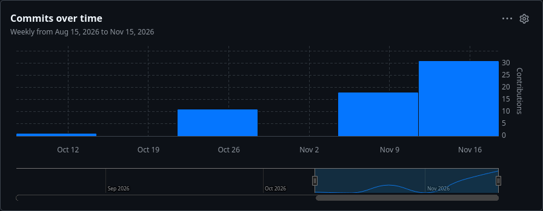

# A. Pregled aktivnosti grupe

**Cilj:** Prikazati kako je tim organizirao projekt, raspodijelio rad, reagirao na važne probleme i pridonio rezultatu. Zapisi trebaju opisivati ishode, a ne samo navoditi da je sastanak održan ili da se o nekoj temi raspravljalo.

## A.1 Evidencija sastanaka

**Cilj:** Voditi kratak zapis projektnih sastanaka i tjedne koordinacije: tko je sudjelovao, što je odlučeno i koja je radnja uslijedila. Raspravu koja nije dovela do odluke zabilježite samo ako je važno pitanje ostalo otvoreno.

**Kratice članova tima:** 		
- LC=Lucija Cvetković
- NS=Noah Sitar
- MM=Marko Mišković
- KK=Kristijan Kralj
- SR=Sven Rešetar
- KM=Karlo Mijić
- MV=Marko Vrančić

| Datum i sudionici | Glavna tema | Donesena odluka ili zadatak  | Poveznica na zadatak ili  rezultat, ako postoji |
| --- | --- | --- | --- |
| 29.10.2026.;  LC NS MM SR KM MV KK | Raspodjela rada i plan napretka projekta | Početi rad na "4-Arhitektura-i-oblikovanje.md" i na frontend-u | <https://github.com/TvrdanTravarFER/Pasuljci/pull/31> |
| 12.11.2026.;  LC NS MM SR KM MV KK | Odabir alata i arhitektura aplikacije | Napraviti bazu podataka i početi rad na backend-u | <https://github.com/TvrdanTravarFER/Pasuljci/pull/30> <https://github.com/TvrdanTravarFER/Pasuljci/pull/39> |

Za svaki relevantan sastanak ili zapis tjedne koordinacije upišite jedan sažet redak. Dodijeljeni zadatak treba imati odgovornu osobu; za neriješeno pitanje treba navesti tko će ga dalje obraditi. Sam naslov sastanka ne pokazuje što se promijenilo. U ovu evidenciju nemojte kopirati cijeli popis issuea ni prijepis razgovora.

<strong>Primjer evidencije sastanaka (CrisisMap)</strong>

**Primjer — CrisisMap:**

**Kratice članova tima:** AK = Ana Kovač; LM = Luka Marić; EP = Ema Petrović; NK = Nika Kralj.

| Datum i sudionici | Glavna tema | Odluka, radnja ili otvoreno pitanje | Poveznica na zadatak ili nastali rezultat, ako postoji |
| --- | --- | --- | --- |
| 15. 11. 2025.; AK, LM, EP | Lokacija kada je pristup preglednika odbijen | Dodati ručni odabir položaja na karti u obrazac za prijavu. AK obrađuje obrazac; LM provjerava valjanost lokacije. | Zadataka #21 i #23. |
| 22. 11. 2025.; AK, EP | Usklađivanje formata lokacijskih podataka | klijentski dio i poslužiteljski API koriste neusklađene formate koordinata. EP će uskladiti format zahtjeva i demonstrira spremanje na sljedećem pregledu. | Zadatak #25. |

**Ishod i odgovornost:** Zapisi jasno definiraju tko je odgovoran za koji dio posla i koji je provjerljivi rezultat dogovoren. npr Rečenica „Raspravljali smo o obradi lokacije” prikrila bi je li se itko obvezao na promjenu. Ovi redci navode odluku ili otvorenu radnju, odgovornu osobu i rezultat koji se može pregledati.

## A.2 Plan rada

**Cilj:** Prikazati planirani redoslijed rada i odgovornosti u timu. Prikažite projektne tjedne ili druga kratka razdoblja koja tim koristi, uključujući pripremu za formalne provjere.

**Trenutačni plan:** Glavni prikaz plana rada je tablica u ovoj dokumentaciji. Zadaci se prate putem GitHub Issues, a promjene i napredak razvoja putem Pull Requestova. Za ažurnost plana zaduženi su svi članovi tima.

| Razdoblje | Glavni planirani rad | Odgovorni članovi | Poveznica na zadatke |
| --- | --- | --- | --- |
| 29. 10. – 11. 11. | Ažuriranje zapisa o raspodjeli rada, izrada projektne dokumentacije te početak razvoja frontenda | MM, MV | [PR #1](https://github.com/TvrdanTravarFER/Pasuljci/pull/1), [PR #2](https://github.com/TvrdanTravarFER/Pasuljci/pull/2), [PR #4](https://github.com/TvrdanTravarFER/Pasuljci/pull/4), [PR #5](https://github.com/TvrdanTravarFER/Pasuljci/pull/5), [#14](https://github.com/TvrdanTravarFER/Pasuljci/issues/14), [#15](https://github.com/TvrdanTravarFER/Pasuljci/issues/15), [#16](https://github.com/TvrdanTravarFER/Pasuljci/issues/16) |
| 12. 11. – 20. 11. | Izrada baze podataka, razvoj backenda i frontenda, izrada ER i UML dijagrama, dovršavanje projektne dokumentacije i priprema prve predaje | MV, MM, KK, KM, NS, SR, LC | [#6](https://github.com/TvrdanTravarFER/Pasuljci/issues/6), [#8](https://github.com/TvrdanTravarFER/Pasuljci/issues/8), [#9](https://github.com/TvrdanTravarFER/Pasuljci/issues/9), [#10](https://github.com/TvrdanTravarFER/Pasuljci/issues/10), [#17](https://github.com/TvrdanTravarFER/Pasuljci/issues/17), [#19](https://github.com/TvrdanTravarFER/Pasuljci/issues/19), [#21](https://github.com/TvrdanTravarFER/Pasuljci/issues/21), [#26](https://github.com/TvrdanTravarFER/Pasuljci/issues/26), [#32](https://github.com/TvrdanTravarFER/Pasuljci/issues/32)|

<strong>Primjer plana rada</strong>

**Primjer — CrisisMap:** Plan rada obuhvaća razvoj prijava, karte i postavljanja aplikacije. Za svako razdoblje navedeni su glavni zadaci i odgovorni članovi.

| Razdoblje | Glavni planirani rad | Odgovorni članovi | Poveznica na zadatke/opis |
| --- | --- | --- | --- |
| Projektni tjedan 6 | Obrazac za prijavu i provjera valjanosti lokacije | AK, LM | Zadataka #21 i #23. |
| Projektni tjedan 7 | Povezivanje obrasca s API-jem za prijave | EP | Zadatak #25. |

**Čitanje plana:** Kratice štede prostor u sažetom planu; njihove definicije s početka A.1 vrijede u cijelom ovom primjeru. Kada rad kasni, ažurirajte stvarni zadatak i očekivanje u planu; nemojte tvrditi da je nedovršena funkcionalnost završena samo zato što je predviđeni tjedan prošao.

## A.3 Aktivnosti i doprinosi članova

**Cilj:** Prikazati koji su članovi radili na važnim projektnim aktivnostima i približan trud koji prijavljuju. Uz implementaciju uključite oblikovanje, dokumentaciju, integraciju, ispitivanje i postavljanje.

| Aktivnost ili rezultat | Član | Prijavljeni sati | Reprezentativni rezultat ili poveznica |
| --- | --- | --- | --- |
| Izrada baze podataka | MV | 35 | [PR #30](https://github.com/TvrdanTravarFER/Pasuljci/pull/30) |
| Izrada početne dokumentacije | MV | 35 | [PR #2](https://github.com/TvrdanTravarFER/Pasuljci/pull/2), [PR #4](https://github.com/TvrdanTravarFER/Pasuljci/pull/4) |
| Izrada frontenda | MM | 45 | [PR #31](https://github.com/TvrdanTravarFER/Pasuljci/pull/31) |
| Izrada projektne dokumentacije - arhitekturne odluke, model podataka i oblikovanje razreda te ponašanje tijekom izvođenja | LC, SR | LC: SR: | [PR #23](https://github.com/TvrdanTravarFER/Pasuljci/pull/23), [PR #37](https://github.com/TvrdanTravarFER/Pasuljci/pull/37), [PR #38](https://github.com/TvrdanTravarFER/Pasuljci/pull/38) |
| Razvoj backenda | KK, KM, NS | KK: KM: NS: | [Issue #32](https://github.com/TvrdanTravarFER/Pasuljci/issues/32) |

Koristite aktivnosti specifične za projekt umjesto obaveznog retka za svako poglavlje dokumentacije ili svaki UML dijagram. Tim treba dosljedno bilježiti sate i izbjegavati dvostruko brojanje zajedničkog rada; reprezentativni rezultat objašnjava što je prijavljeni trud proizveo. Sati su samoprijavljena procjena uloženog rada, a ne mjera kvalitete niti zamjena za pregled koda i artefakata.

<strong>Primjer aktivnosti i rezultata rada</strong>

**Primjer — CrisisMap:** Tablica razlikuje implementaciju, integraciju i dokumentaciju te svaku aktivnost povezuje s rezultatom.

| Aktivnost ili rezultat | Član | Prijavljeni sati | Reprezentativni rezultat ili poveznica |
| --- | --- | --- | --- |
| Ručni unos položaja na karti | AK | 8 | Zadatak #21; promjena klijentskog dijela. |
| Provjera valjanosti i trajna pohrana prijave | LM | 10 | Zadatak #23; promjena pozadinskog sustava i ispitivanje. |
| Integracija klijenta i API-ja te javno postavljanje | EP | 7 | Zadatak #25; konfiguracija u `render.yaml` i `dist/` |
| Obrazac uporabe za podnošenje prijave i provjera odbijenog dopuštenja | NK | 5 | Završene izmjene UC-002 i ispitivanje ST-03. |

**Trud i rezultat:** Završni stupac omogućuje raspravu o doprinosu bez tretiranja velikog broja sati kao dokaza isporuke. Tim može prijaviti stvarno dugotrajan, još neriješen problem integracije kao obavljen rad i iskreno opisati njegov ishod.

## A.4 Pregled promjena u repozitoriju

**Cilj:** Prikazati kada su promjene napravljene u repozitoriju i tko ih je napravio, uz napomenu da sam broj zapisa promjena ne mjeri kvalitetu doprinosa.

**Prikaz aktivnosti repozitorija:** [Ugradite ili povežite GitHubov prikaz `Contributors` i generirani graf za projektni repozitorij; navedite razdoblje koje obuhvaća.]

GitHubov prikaz `Contributors` za projektni repozitorij: <https://github.com/TvrdanTravarFER/Pasuljci/graphs/contributors>

**Razdoblje koje prikaz obuhvaća:** `11.10.2026.` - `15.11.2026.`

Graf može pokazati kada su zapisi promjena napravljeni i tko ih je napravio, ali ne prikazuje sav rad na oblikovanju, ispitivanju, integraciji, pregledu ili dokumentaciji. Ako postoji uočljiv nesklad s tablicom aktivnosti, kratko ga objasnite; nemojte iz grafa izvoditi broj sati. Generirani prikaz neka bude vezan uz stvarni repozitorij umjesto da se ručno crta drugi graf.

## A.5 Ključni inženjerski izazovi i rješenja

**Cilj:** Dokumentirati stvarne tehničke i organizacijske prepreke s kojima se tim suočio, poduzete korektivne inženjerske korake te konačni ishod. Odaberite konkretne izazove umjesto općenite pohvale timskog rada.

| Izazov | Poduzeta radnja | Ishod ili preostalo ograničenje |
| --- | --- | --- |
|  |  |  |

<strong>Rješavanje nesklada formata lokacije</strong>

**Primjer — CrisisMap:**

| Izazov | Poduzeta radnja | Ishod ili preostalo ograničenje |
| --- | --- | --- |
| Odabrani položaj na karti prikazivao se u klijentu, ali podnesena prijava nije zadržavala koordinate. | AK i EP usporedile su zahtjev preglednika s poljima lokacije koje očekuje API; AK je uskladila format zahtjeva, a LM je dodao provjeru valjanosti lokacije. | Nova prijava u ovom se scenariju može dohvatiti sa spremljenim položajem; tim povezuje odgovarajuću promjenu integracije i provjeru. |

**Problem, odgovor i ishod:** Svaki se dio može provjeriti u projektu. Rečenica poput „imali smo poteškoće s integracijom i riješili ih timskim radom” ne bi čitatelju rekla što nije radilo ni kako je rješenje promijenjeno.

---

>**Završna provjera:** Sastanci navode smislene ishode i odgovorne osobe; plan odražava namjeravani rad; tablica uloženog rada i generirani prikaz repozitorija odnose na ovaj vidljivi projekt; konkretni izazovi povezani su s radnjama i njihovim rezultatima. 
