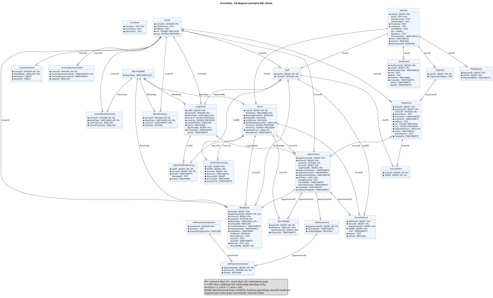

# KrvnaVeza - ER model

[Otvori puni SVG za povećavanje](assets/diagrams/4-2-KrvnaVeza-data-ERD.svg) · [PlantUML izvor](puml/4-2-KrvnaVeza-data-ERD.puml) · [SQL shema](../db/schema.sql)

## Opseg i izvori

Relacijski ER dijagram prikazuje svih **25 tablica, 150 stupaca i 41 strani ključ** iz `db/schema.sql`, pregledano prema `main` na commitu `e7b6e32`. Shema je u tom trenutku jednaka shemi grane `database`. Dijagram je potpuni prikaz postojeće definicije baze, a ne tvrdnja da su sve funkcionalnosti već implementirane. Zbog veličine modela za čitanje atributa treba otvoriti puni SVG i povećati ga.

Model je uspoređen s projektnim zadatkom **G10 - SK1-KrvnaVeza.pdf**, str. 2-4, [analizom zahtjeva](2-Analiza-zahtjeva.md) i [obrascima uporabe](3-Obrasci-uporabe.md). Notacija s račvom slijedi ER primjer u predlošku kolegija [4-2-crisismap-data-ERD.puml](puml/4-2-crisismap-data-ERD.puml) i odjeljak [4.3.1](4-Arhitektura-i-oblikovanje.md#431-er-dijagram-i-model-podataka). ER nije UML dijagram razreda.

## Čitanje dijagrama

- **PK**: primarni ključ; više oznaka PK u istoj tablici čini jedan složeni ključ.
- **FK**: strani ključ; **UQ**: jedinstvena vrijednost pojedinog stupca.
- Oznaka obaveznog atributa (`*` u izvoru, puna točka na slici) označava `NOT NULL`, uključujući primarne ključeve. Ostali stupci dopuštaju `NULL`, ali CHECK ograničenje može zahtijevati vrijednost u određenom stanju.
- Kružnica na vezi znači nula, crtica jedan, račva više. Oznaka uz kraj veze govori koliko zapisa na tom kraju može pripadati jednom zapisu na suprotnom kraju.
- Primjer: `Donor ||--o{ Appointment` znači da darivatelj može imati nula ili više rezervacija, a rezervacija pripada točno jednom darivatelju.
- Nazivi su doslovno preuzeti iz SQL-a, uključujući postojeći naziv `DefferalID`. Ispravljeni nazivi `SelfAssessmentQuestion` i `NotificationID` odgovaraju novoj shemi.

## Pokrivenost projekta

| Područje | Entiteti / način pohrane |
| --- | --- |
| Korisnici i uloge | `AppUser`, `Donor`, `Staff`, `Organizer`, `RoleRequest`; administrator je vrijednost `AppUser.Role`. |
| Centri i termini | `Center`, `CenterWorktime`, `CenterAppointmentSlot`; slot sadrži konkretni početak i kraj s datumom i vremenskom zonom. |
| Terenske akcije | `FieldAction`, `TraumaTeam`; potonji povezuje akciju i djelatnike mobilnog tima. |
| Rezervacije i podobnost | `Appointment`, `SelfAssessment`, `SelfAssessmentQuestion`, `SelfAssessmentAnswer`, `DonorDeferral`, `Constants`. |
| Doze i zalihe | `BloodDose`, `BloodTypeRef`, `CenterBloodThreshold`, `BloodStockLog`. |
| Hitni pozivi | `UrgentCall`, `UrgentCallRecipientLog`, veza `Appointment.UrgentCallID` za praćenje odaziva. |
| Obavijesti i priznanja | `Notification`, `DonorBadge`; kanali i udaljenost za obavijesti u profilu `Donor`. |
| Pristup zdravstvenim podacima | `SensitiveAccessLog`; svaki pristup odgovorima i odgodama treba upisati aplikacija. |
| Vanjske integracije | OAuth identitet u `AppUser`, `QrToken` i `GoogleEventId` u `Appointment`, `MessageID` u dnevniku hitnih poziva. Vanjski servisi nisu tablice baze. |
| Potvrde PDF i izvozi | Generiraju se iz zapisa; u zadatku nije traženo trajno spremanje tih datoteka kao zasebnih entiteta. |

Pogledi `CenterBloodStock`, `BloodStockTotal`, `UrgentCallResponse`, `ActionStats` i `StockForecast` izvode podatke iz tablica pa nisu dodatni pohranjeni entiteti na ER dijagramu. `BloodStockLog` jest tablica za povijesne snimke. `IssuedTo` u dozi pohranjuje odredišnu bolnicu; posebna tablica bolnica ne postoji u trenutačnoj shemi.

## Ograničenja koja nisu vidljiva samo iz kardinalnosti

1. **Mjesto rezervacije:** `Appointment` mora imati točno jedan od `CenterID` i `ActionID` (XOR, SQL CHECK). Dvije pojedinačne veze 0..1 ne znače da je dopušteno nemati nijednu ili imati obje.
2. **Profili:** svaki profil ima jednog korisnika; korisnik ima najviše jedan profil svake vrste. Međusobna isključivost profila i usklađenost s `AppUser.Role` nisu zajamčene samim FK vezama. OAuth identitet dodatno ima složeni UNIQUE `(OAuthProvider, OAuthSubject)`.
3. **Samoprocjena i doza:** rezervacija ima 0..1 samoprocjenu i 0..1 dozu. Zahtjev samoprocjene prije potvrde i doze nakon uspješnog darivanja provodi poslovni proces, a ne minimalna kardinalnost veze.
4. **Odgoda:** privremena odgoda ima `Until` i `Infinite = FALSE`; trajna ima `Until = NULL` i `Infinite = TRUE`. `Reason` je obavezan. Poveznica na rezervaciju je neobavezna, a više odgoda može se odnositi na istu rezervaciju.
5. **Akcija:** za stanja osim `PROPOSED` i `CANCELLED` SQL traži centar. Dodjela mobilnog tima pri prihvaćanju zahtjev je poslovnog procesa. `ExpectedDonors` je očekivani broj darivatelja, ne deklarirani kapacitet.
6. **Slot:** `CenterAppointmentSlot` ima složeni PK `(CenterID, CenterAppointmentStart)`, kapacitet i kraj istog datuma. `Appointment` nema FK na slot; usklađenost vremena i provjera kapaciteta ostaju poslovna odgovornost. `CenterWorktime` zasebno opisuje tjedno radno vrijeme.
7. **Hitni poziv:** stanje `SENT` zahtijeva `ApprovedBy` i `SentAt`. `UrgentCallRecipientLog` razrješava vezu više-na-više između poziva i darivatelja.
8. **Zapis pristupa:** `SensitiveAccessLog.ResourceID` nema FK jer značenje ovisi o `Resource`. Ne dodajemo izmišljene FK veze prema upitniku i odgodi.

## Granice provjere i otvorena pitanja implementacije

Struktura dijagrama provjerena je usporedbom tablica, stupaca, tipova, primarnih i stranih ključeva, jednostupčanih UNIQUE ograničenja te obveznosti i kardinalnosti. SQL nije izvršen na PostgreSQL poslužitelju tijekom ove provjere. Dijagram ne mijenja bazu.

- SQL CHECK popisuje osam statusa rezervacije, ali ne provodi cijeli graf dopuštenih prijelaza. `AppointmentUpdate` provjerava redovno otkazivanje iz `RESERVED` i vremenski rok te postavlja `CancelledAt` i `StatusChangedAt`. [UML model ponašanja](UML-ponasanje.md) opisuje ciljni tijek.
- `BloodDose.dose_ok` zahtijeva da test za `STOCK` i `ISSUED` nije NULL, ali ne zahtijeva TRUE. Zahtjev zadovoljavajućeg testiranja stoga treba dodatno provesti. Potrebna je i provjera podudaranja darivatelja i mjesta doze s rezervacijom.
- U trenutačnoj shemi funkcija `DiscardExpiredDoses` koristi `Status`/`ExpiresAt`, iako tablica ima `DoseStatus`/`ExpirationDate`; `AnonymizeUser` koristi `Appointment.Status` umjesto `AppointmentStatus`. To su zapažanja iz čitanja SQL-a, ne rezultat izvršavanja. Ove implementacijske razlike nisu razlog za crtanje nepostojećih atributa.
- `StockForecast` je dodan, ali izraz `u.Issued / 30` koristi cjelobrojno dijeljenje; pri maloj potrošnji nazivnik može postati nula. Izračun treba provjeriti prije uporabe u aplikaciji.
- Zadatak govori o mjesecu blokade i mjesecima između darivanja, a parametri sheme o 30 i 90/120 dana. Kalendarsko tumačenje treba usuglasiti; ER ne mijenja postojeće parametre.
- Provjera kapaciteta, ovlasti, podobnosti, zabrane preklapanja i anonimizacija zahtijevaju poslovnu logiku. Samo postojanje stupca ili FK veze ne dokazuje njihovu implementaciju.

Izrađeno i revidirano uz pomoć Codexa. Pregled članova tima odvija se kroz pull request; ova bilješka ne tvrdi da je ljudski pregled već obavljen.
