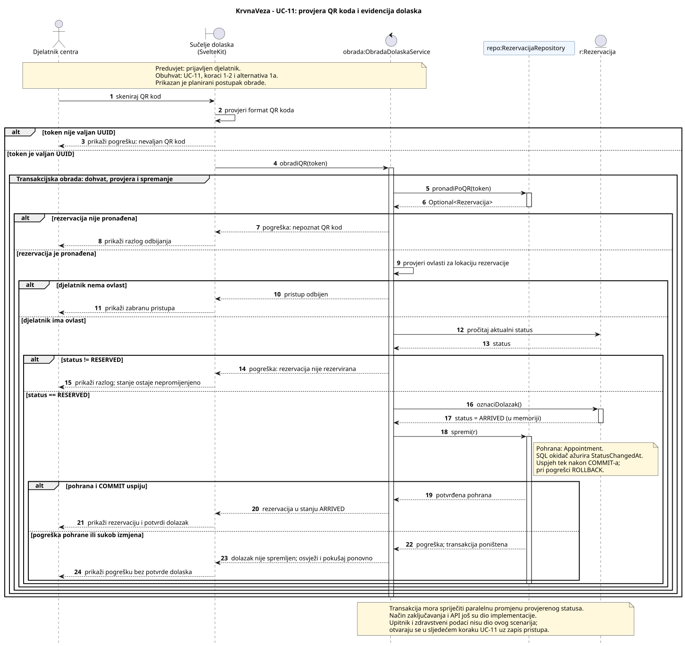
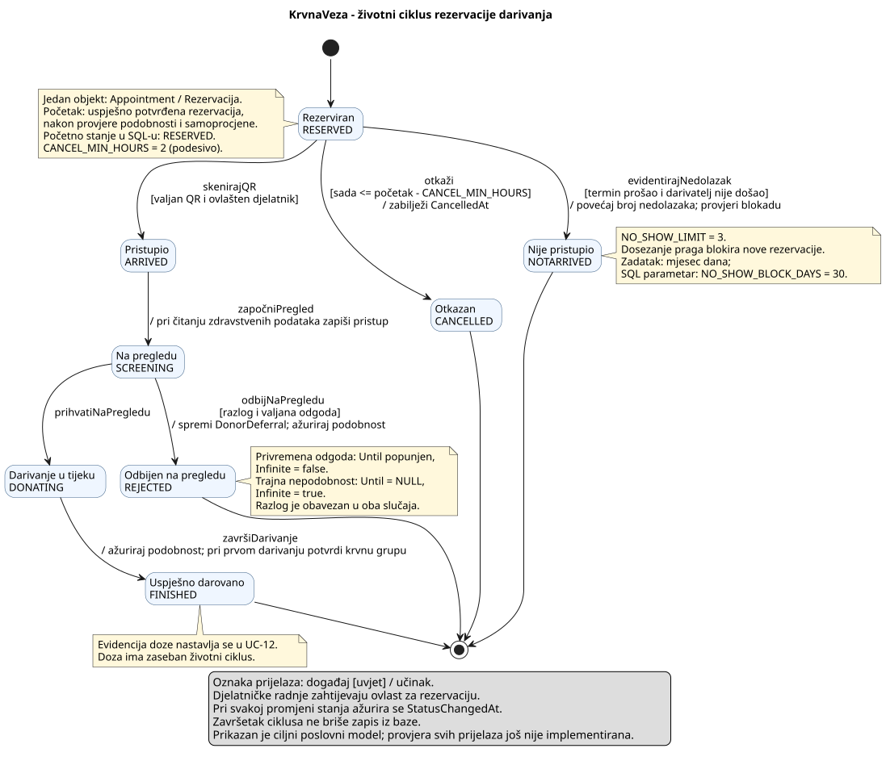

# KrvnaVeza - reprezentativni UML modeli ponašanja

## Status i izvori

Dijagrami predstavljaju **ciljno oblikovanje** prema zahtjevima projekta. Nisu snimka dovršene aplikacije. Pregledani su `main` na `e7b6e32`, grana `backend` na `b578f13` i timski [dijagram razreda](puml/4-3-KrvnaVeza-domain-CD.puml). Poslovne metode u `ObradaDolaskaService` na pregledanoj backend grani još su nedovršene. `Rezervacija` sadrži mapiranje na `Appointment` i osnovne promjene statusa, ali ne provjerava cijeli životni ciklus.

| Izvor | Primjena |
| --- | --- |
| Projektni zadatak **G10 - SK1-KrvnaVeza.pdf**, str. 2-3 | QR, otkazivanje, osam stanja rezervacije, odgode, nedolasci i evidencija doze. |
| [Analiza zahtjeva](2-Analiza-zahtjeva.md), F-015-F-020, NF-02 i NF-03 | Rok otkazivanja, dolazak, dopušteni prijelazi, ovlasti i zapis pristupa osjetljivim podacima. |
| [Obrasci uporabe](3-Obrasci-uporabe.md), UC-05, UC-06, UC-11 i UC-12 | Stvaranje i otkazivanje rezervacije, obrada dolaska, ishodi pregleda i nastavak evidencijom doze. |
| **PROINZ_26_04_UML_v1.0.pdf**, PDF stranice 62-67 i 77 | Životne linije, redoslijed poruka, povratne poruke, `alt`, razina oblikovanja i potvrda nakon trajne pohrane. PDF stranice i brojevi slajdova nisu svugdje jednaki. |
| Predložak kolegija, [4.4.1 i 4.4.2](4-Arhitektura-i-oblikovanje.md#44-ponašanje-tijekom-izvođenja) | Jedan reprezentativni scenarij s alternativama i životni ciklus jednog objekta; jednostavniji model kada nema potrebe za ortogonalnim stanjima. |
| [SQL shema](../db/schema.sql) | `Appointment`, statusi, QR token, vremenska polja, odgode i parametri pravila. |

## Sekvencijski dijagram: dolazak s QR kodom

[Puni SVG](assets/diagrams/4-4-KrvnaVeza-check-in-SD.svg) · [PlantUML izvor](puml/4-4-KrvnaVeza-check-in-SD.puml)

**Scenarij:** UC-11, koraci 1-2 i alternativa 1a, uz odbijanje neovlaštenog pristupa i neuspjelu pohranu. Prijavljen djelatnik skenira kod, sustav pronalazi rezervaciju, provjerava ovlast i stanje `RESERVED`, zatim trajno sprema `ARRIVED`. Korisnik dobiva potvrdu tek nakon uspješnog dovršetka transakcije. Ponovljeni ili otkazani kod ne smije ponovno promijeniti stanje.

To je dijagram oblikovanja: prikazuje sučelje, aplikacijski servis, repozitorij i domenski objekt. Nazivi `ObradaDolaskaService`, `RezervacijaRepository`, `Rezervacija`, `obradiQR`, `pronadiPoQR` i `oznaciDolazak` postoje u timskom oblikovanju i početnom backend kodu. `spremi(r)` je logička operacija iz dijagrama razreda; na Spring Data repozitoriju odgovara naslijeđenoj operaciji `save`. Provjera ovlasti i čitanje statusa opisuju odgovornosti, ne tvrdnju da već postoje metode tih naziva. API kontroler i transport izostavljeni su radi reprezentativnog opsega.

| Put | Očekivani ishod |
| --- | --- |
| Nevaljan format QR podatka | Sučelje odbija podatak prije poziva servisa; poslužiteljska ulazna granica mora također validirati unos. |
| Ispravan UUID bez odgovarajuće rezervacije | Poruka o nepoznatom kodu, bez izmjene. |
| Djelatnik bez ovlasti za lokaciju | Pristup odbijen, bez izmjene ili prikaza rezervacije. |
| Status nije `RESERVED` | Odbijanje, uključujući otkazanu ili već obrađenu rezervaciju. |
| Valjana rezervacija i uspješan commit | `ARRIVED`, ažuriran `StatusChangedAt`, prikazana potvrda. |
| Pogreška pohrane ili sukob paralelnih izmjena | Rollback; nema potvrde dolaska i trajni zapis se ne mijenja ovom operacijom. |

Provjera aktualnog stanja i spremanje moraju biti zaštićeni jednom transakcijom i odgovarajućom kontrolom konkurentnosti. Dijagram ne propisuje konkretan mehanizam zaključavanja. `save` sam po sebi ne znači da je vanjska transakcija već potvrđena; odgovor korisniku slijedi tek nakon stvarnog COMMIT-a. Ako pohrana ne uspije, izmijenjeni objekt u memoriji ne koristi se kao potvrda trajnog stanja.

Upitnik nije prikazan: njegova obrada počinje u sljedećem koraku UC-11. Pri tom pristupu obavezan je `SensitiveAccessLog`. Time se ne miješa samo skeniranje QR-a s pristupom zdravstvenim podacima.

## Dijagram stanja: jedna rezervacija

[Puni SVG](assets/diagrams/4-5-KrvnaVeza-appointment-SM.svg) · [PlantUML izvor](puml/4-5-KrvnaVeza-appointment-SM.puml)

Vlasnik stanja je **jedna `Rezervacija`**, pohranjena kao redak u `Appointment`; stanje je `AppointmentStatus`. Pratimo cijeli redovni životni ciklus, a ne sve zaslone aplikacije ili tok više različitih objekata.

| Izvorno stanje | Događaj i važan uvjet | Novo stanje / učinak |
| --- | --- | --- |
| Početak | Rezervacija je već uspješno potvrđena uz podobnost i samoprocjenu | `RESERVED` |
| `RESERVED` | Valjan QR i ovlašten djelatnik | `ARRIVED` |
| `RESERVED` | Darivatelj otkazuje najkasnije `CANCEL_MIN_HOURS` prije početka | `CANCELLED`, vrijeme otkazivanja |
| `RESERVED` | Djelatnik evidentira da darivatelj nije došao na prošli termin | `NOTARRIVED`, broj nedolazaka i moguća blokada |
| `ARRIVED` | Djelatnik započinje pregled | `SCREENING`; zdravstveni pristup mora biti zabilježen |
| `SCREENING` | Djelatnik prihvaća darivatelja nakon pregleda | `DONATING` |
| `SCREENING` | Djelatnik odbija uz razlog i valjanu privremenu ili trajnu odgodu | `REJECTED`, odgoda i ažurirana podobnost |
| `DONATING` | Djelatnik završava darivanje | `FINISHED`, ažurirana podobnost i potvrda krvne grupe pri prvom darivanju |

`FINISHED`, `REJECTED`, `CANCELLED` i `NOTARRIVED` završni su poslovni ishodi. Strelice prema završnom čvoru označavaju kraj ovog ciklusa, **ne brisanje zapisa**. Evidencija i životni ciklus doze pripadaju UC-12 i drugom objektu. Upitnik je upozorenje za samoprocjenu; medicinsko prihvaćanje ili odbijanje provodi djelatnik na pregledu.

U UC-11 je tekst koraka 4 sažet: na dijagramu je ulazak u `SCREENING` vezan uz početak pregleda, a prihvaćanje nakon pregleda vodi u `DONATING`. Time su odvojena stanja koja projektni zadatak izričito zahtijeva.

## Razlike koje implementacija treba zatvoriti

- SQL popis dopuštenih statusa podudara se s osam stanja dijagrama. Sam CHECK ne zabranjuje proizvoljan prijelaz između dvije dopuštene vrijednosti.
- SQL okidač provodi redovni rok otkazivanja i ažuriranje vremenskih polja. Poseban interni zaobilazak pravila za anonimizaciju nije redovno korisničko otkazivanje i nije dodatni prijelaz prikazanog ciklusa.
- Backend `ObradaDolaskaService.obradiQR` na pregledanom commitu vraća `null`, a promjene stanja u modelu nemaju sve provjere izvornog stanja. Autorizacija, granice transakcije, kontrola konkurentnosti i obrada pogrešaka na dijagramu cilj su implementacije.
- Predikat ovlasti treba provjeriti pripadnost centru, odnosno timu terenske akcije. To je predložena razrada autorizacije po lokaciji, ne postojeće SQL ograničenje.
- Za blokadu nakon tri nedolaska zadatak navodi mjesec, a postojeći parametar 30 dana. Resetiranje brojača i ponašanje nakon isteka blokade nisu precizirani; dijagram ih ne izmišlja.
- Stvaranje odgode i promjena u `REJECTED` trebaju biti atomski. Spremanje `FINISHED` prethodi zasebnom koraku evidentiranja doze iz UC-12; FK veza ne osigurava da je doza već evidentirana.

Izrađeno i provjereno uz pomoć Codexa; timski pregled slijedi kroz pull request. Nisu mijenjani zahtjevi, SQL ni Java kod kako bi odgovarali nacrtanim dijagramima.
