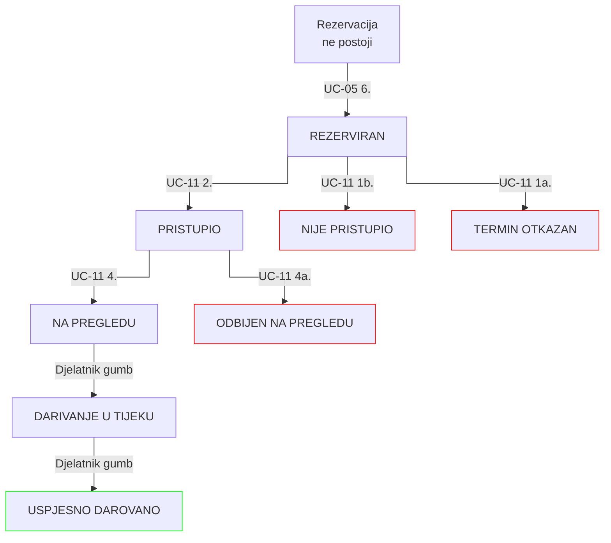
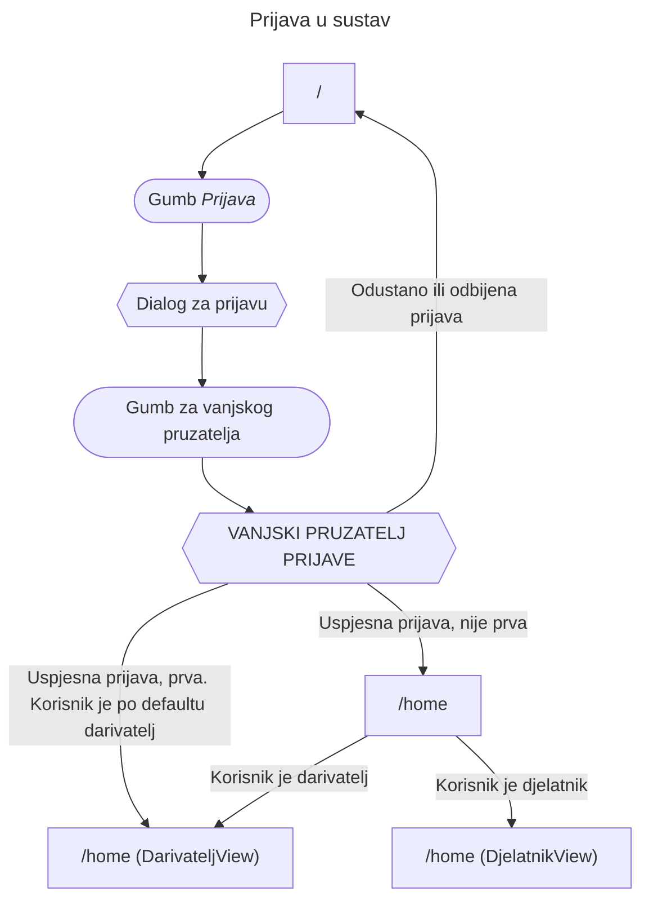
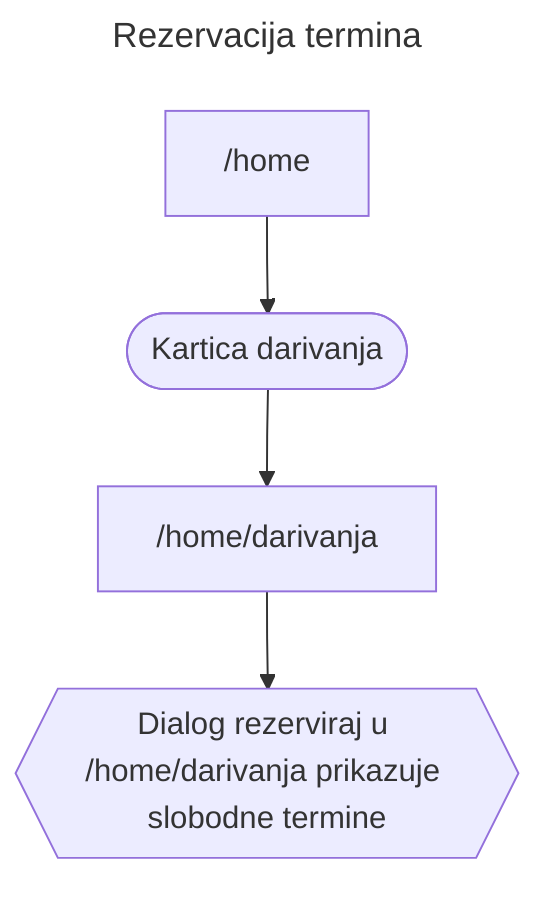

**glavni view**

profil, neki osnovni pregled stanja

**POV: DARIVATELJ**

- gumb za postavke
  - omogucava upravljanje profilom (uc-03)
  - izvoz podataka i brisanje racuna (uc-09)
- kartica "darivanja"
  - omogucava flow za rezervaciju termina (uc-05)
  - otkazivanje rezerviranog termina (uc-06)
  - prijavu na terensku akciju (uc-07)
  - pregled povijesti darivanja (uc-08)

**POV: DJELATNIK**

- kartica "centar"
  - omogucava pogled na statistiku centra, pregled termina i zakazivanje novog s pripadajucim parametrima (uc-10)

tijekom provodjenja termina pali se gumb "termin" koji otvara pogled gdje se moze vidjeti evidencija svih djelatnika. moguce je skenirati direktno qr (djelatnik tad valjda pali kameru mobitela) koja ga onda, pod uvjetom da je prijavljen na njemu u platformu, automatski postavlja na "pristupio" (to mora bit trigger za taj uvjet). zatim djelatnika to salje na ekran za bas taj termin tog darivatelja gdje on vidi rezultate upitnika i ima dva gumba: prihvati i odbij. ako djelatnik procijeni po odgovorima upitnika da darivatelj moze pristupiti darivanju, prihvaca ga (cime se stanje te rezervacije postavlja na "na pregledu") a u protivnom "odbijen na pregledu" sto djelatniku otvara view gdje treba napisati razlog zasto je odbijen kao i mogucu odgodu (privremeno ili trajno). svima koji su na pregledu djelatnik moze jednim klikom na listi (svakom od njih) pribaciti na stanje "darivanje u tijeku" a po zavrsetku i "uspjesno darovano".

kad prodje termin, tad automatski sustav postavlja sve darivatelje koji nisu dosli u stanje "nije pristupio". (iako uc-11 1b kaze da to manualno treba djelatnik al meni je ovako logicnije). ako bilo kad sam darivatelj manualno otkaze, tad se stanje mijenja u "otkazan".

znaci:
```
[rezervacija ne postoji] -> (UC-05 6.) -> [REZERVIRAN]

             -> (UC-11 2. darivatelj dodje u vrijeme i djelatnik skenira njegov QR) -> [PRISTUPIO]
[REZERVIRAN] -> (UC-11 1a. darivatelj otkaze gumbom) -> [TERMIN OTKAZAN]
             -> (UC-11 1b. darivatelj ne dodje na vrijeme) -> [NIJE PRISTUPIO]


[PRISTUPIO] -> (UC-11 4. djelatnik prihvaca darivatelja) -> [NA PREGLEDU]
            -> (UC-11 4a. djelatnik odbija darivatelja) -> [ODBIJEN NA PREGLEDU]

[NA PREGLEDU] -> (nakon sto darivatelj zapocne darivanje, a djelatnik stisne gumb na listi clanova) -> [DARIVANJE U TIJEKU]

[DARIVANJE U TIJEKU] -> (darivatelj gotov, sve u redu) -> [USPJESNO DAROVANO]
```



## Tokovi sucelja



